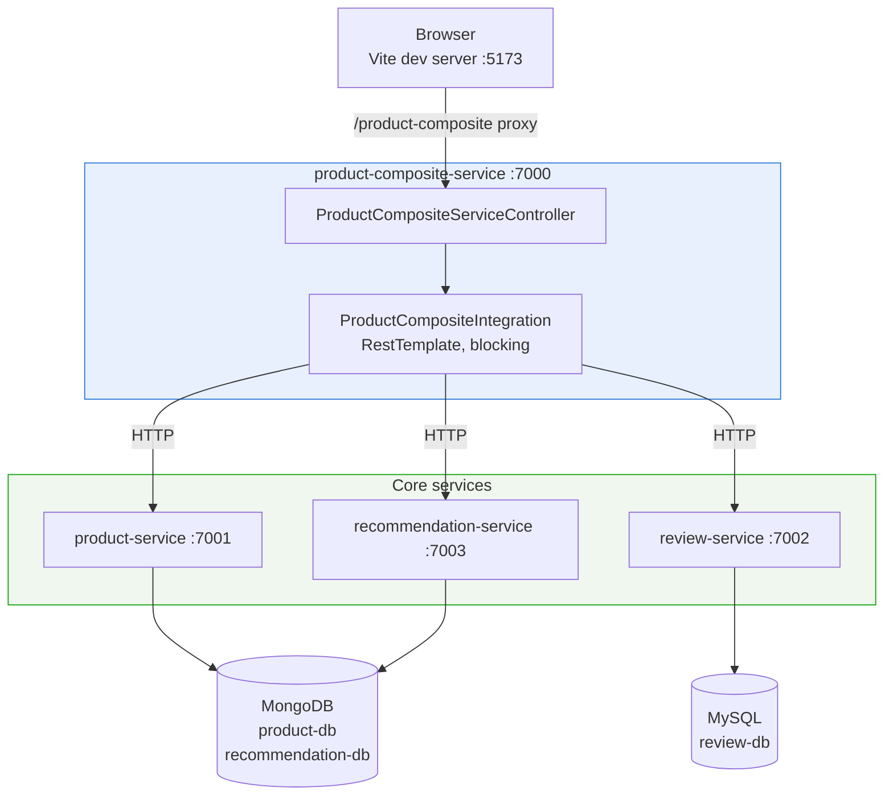
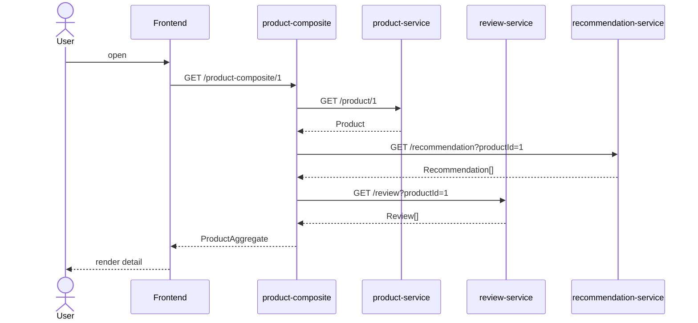
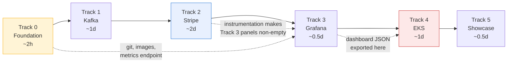
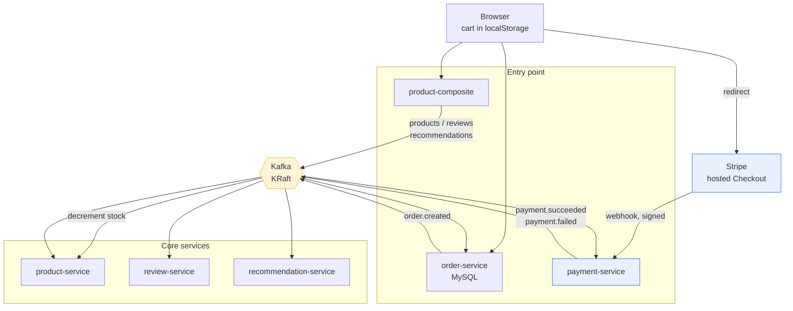
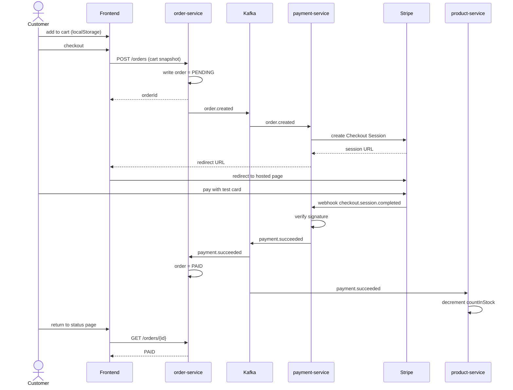
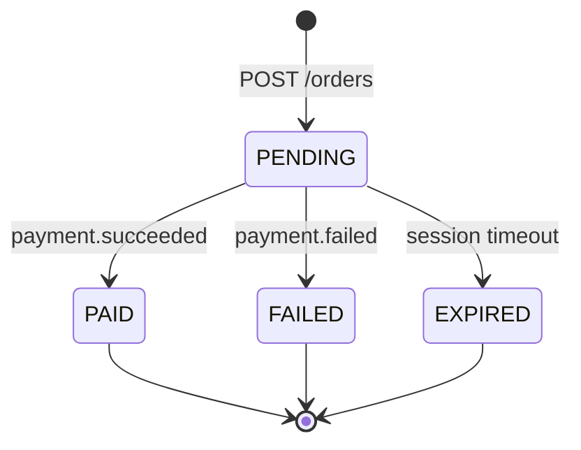
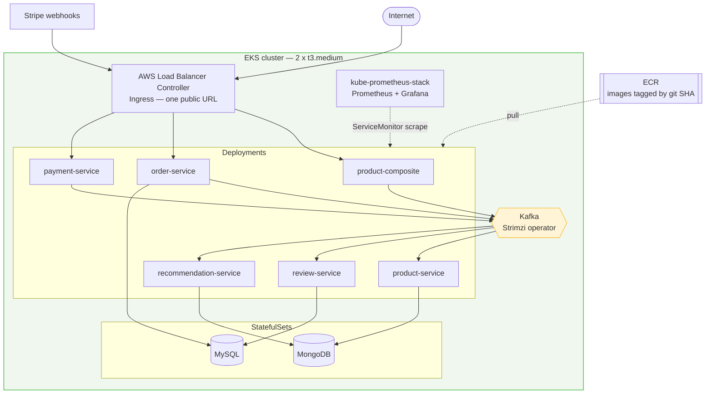

# HCL Gadgets — Architecture & Roadmap

**End-to-end design: current system → Kafka → Stripe checkout → Prometheus/Grafana → EKS.**

| | |
|---|---|
| Repo | [bentabi/Spring-boot-microservice-eCommerce-App](https://github.com/bentabi/Spring-boot-microservice-eCommerce-App) — branch `hcl-gadgets` |
| Plan drafted | 2026-07-21 |
| This document | 2026-11-10 |
| Backend | Spring Boot 2.7.1, Gradle multi-module, Java 8 target |
| Frontend | Vanilla TypeScript + Vite 8, no framework |
| Status | Tracks 1–5 are **design only — not implemented.** Track 0 is partially done. |

> **Sources.** Assembled from files in this repo: `IMPLEMENTATION-PLAN.txt` (526 lines, the design
> record), `poc-requirement.md`, `event-driven-asynchronus.md`, `deploy-using-docker.md`, `README.md`,
> and the source tree itself. Effort estimates and cost figures are the plan's own and should be
> re-verified before being relied on.

---

## Contents

- [1. What this is](#1-what-this-is)
- [2. Current state — what is built](#2-current-state--what-is-built)
- [3. Current architecture](#3-current-architecture)
- [4. Known gaps](#4-known-gaps)
- [5. Roadmap overview](#5-roadmap-overview)
- [6. Track 0 — Foundation](#6-track-0--foundation)
- [7. Track 1 — Kafka & event-driven refactor](#7-track-1--kafka--event-driven-refactor)
- [8. Track 2 — Cart, checkout & Stripe](#8-track-2--cart-checkout--stripe)
- [9. Testing the payment system](#9-testing-the-payment-system)
- [10. Metrics instrumentation](#10-metrics-instrumentation)
- [11. Track 3 — Grafana dashboard](#11-track-3--grafana-dashboard)
- [12. Track 4 — EKS deployment](#12-track-4--eks-deployment)
- [13. Track 5 — Showcase](#13-track-5--showcase)
- [14. Open decisions](#14-open-decisions)
- [15. Appendix — diagram assets](#15-appendix--diagram-assets)

---

## 1. What this is

HCL Gadgets is a B2C e-commerce system for online retail of electronics — phones, laptops, TVs,
computers. Customers browse by category, read product details, reviews and recommendations, and
(once Track 2 lands) buy through a hosted Stripe checkout.

The original POC requirement defined two scope levels:

| Level | Use cases | Services |
|---|---|---|
| **Level 0** | get user details, user registration, login | user-service |
| **Level 1** | the above + list products, get product details | user-service, product, recommendation, review |

**Current reality:** Level 1's product side is complete. Level 0 was never built — there is no
user-service, so checkout is designed for **anonymous** customers (see [D2](#14-open-decisions)).

---

## 2. Current state — what is built

### Modules

| Module | Persistence | State |
|---|---|---|
| `api` | — | Shared DTOs, exceptions, service interfaces — **done** |
| `util` | — | `ServiceUtil`, global exception handler — **done** |
| `product-service` | MongoDB | Full CRUD + name search, mapper, tests — **done** |
| `recommendation-service` | MongoDB | Full CRUD + single-delete — **done** |
| `review-service` | MySQL / JPA | Full CRUD + single-delete — **done** |
| `product-composite-service` | — | Aggregator, **synchronous blocking** calls, springdoc OpenAPI — **done** |
| `frontend` | localStorage | Vite + TS catalog UI — **done** |

### Ports

| Service | Local | Docker | Store |
|---|---|---|---|
| product-composite-service | 7000 | 8080 | — |
| product-service | 7001 | 8080 | MongoDB |
| review-service | 7002 | 8080 | MySQL |
| recommendation-service | 7003 | 8080 | MongoDB |
| mongo-express | — | 8081 | MongoDB UI |
| adminer | — | 8082 | MySQL UI |
| MySQL | 3307 | 3306 | — |
| Vite dev server | 5173 | — | — |

### Endpoints

**product-composite-service** — the only service the browser talks to

| Method | Path | Operation |
|---|---|---|
| `GET` | `/product-composite` | list all |
| `GET` | `/product-composite/search?name=` | search by name |
| `GET` | `/product-composite/{productId}` | detail, with reviews + recommendations |
| `POST` | `/product-composite` | create (fans out to all three) |
| `POST` | `/product-composite/{productId}/review` | add review |
| `POST` | `/product-composite/{productId}/recommendation` | add recommendation |
| `DELETE` | `/product-composite/{productId}` | delete product + children |
| `DELETE` | `/product-composite/{productId}/review/{reviewId}` | delete one review |
| `DELETE` | `/product-composite/{productId}/recommendation/{recommendationId}` | delete one recommendation |

**product-service**

| Method | Path |
|---|---|
| `GET` | `/product` |
| `GET` | `/product/search?name=` |
| `GET` | `/product/{productId}` |
| `POST` | `/product` |
| `DELETE` | `/product/{productId}` |

**recommendation-service**

| Method | Path |
|---|---|
| `GET` | `/recommendation?productId=` |
| `POST` | `/recommendation` |
| `DELETE` | `/recommendation?productId=` |
| `DELETE` | `/recommendation/{productId}/{recommendationId}` |

**review-service**

| Method | Path |
|---|---|
| `GET` | `/review?productId=` |
| `POST` | `/review` |
| `DELETE` | `/review?productId=` |
| `DELETE` | `/review/{productId}/{reviewId}` |

### Frontend features

Hash router with four routes — `#/` list, `#/search/:term`, `#/product/:id`, `#/create`.

- List auto-refreshes every 5s, re-rendering **only** the list container so search-box focus survives
- Transient fetch errors keep the last good content rather than blanking the view
- Broken image URLs fall back to a "No image" placeholder via `onerror`
- Detail view: star-rendered recommendations, reviews, inline add + delete for both
- Create form: 9 fields, posts to the composite, redirects to the list
- Vite proxies `/product-composite` so the browser stays same-origin — **no CORS config on any service**

### Test suite — 15 files, 75 `@Test` methods

| Service | Unit (mocked) | Integration (Testcontainers) | Context |
|---|---|---|---|
| product-composite | 13 controller + 18 integration-client | — | 1 |
| product | 9 | 7 (MongoDB) | 1 |
| recommendation | 6 | 6 (MongoDB) | 1 |
| review | 6 | 6 (MySQL) | 1 |

Plus `test-em-all.bash` for end-to-end smoke testing, and JaCoCo 0.8.8 wired into every service
(`finalizedBy jacocoTestReport`, HTML + CSV).

Testcontainers is pinned to Docker API `1.44` — Docker Engine 28+ enforces that as a minimum, and
without the pin the integration tests cannot reach a modern daemon.

---

## 3. Current architecture



**The read path today** — note it is fully synchronous, three sequential blocking calls:



---

## 4. Known gaps

These break assumptions in the original deployment plan and must be addressed in order.

| # | Gap | Consequence |
|---|---|---|
| 1 | ~~Not a git repository~~ | **Resolved 2026-11-10** — `git init`, pushed to `hcl-gadgets` |
| 2 | `/actuator/prometheus` does not exist | No `micrometer-registry-prometheus` dependency; Prometheus would have nothing to scrape |
| 3 | Kafka is documentation only | `event-driven-asynchronus.md` describes it and `EventProcessingException` exists, but there is no `spring-cloud-stream` dependency, no `Event` class, no broker. Composite create/delete are synchronous |
| 4 | No user-service | POC Level 0 (register / login / get user) never built, so Level 1 is partial |
| 5 | No gateway, service discovery or config server | Composite hardcodes hostnames per Spring profile; frontend still needs one public entry point |
| 6 | Dockerfiles use `adoptopenjdk:16_36-jre-hotspot` | Deprecated and unmaintained; must be replaced before pushing to ECR |
| 7 | Scope mismatch | "Deploy your payment app" is really 6–7 services + 2 databases + Kafka |

---

## 5. Roadmap overview

**The one big change from the original plan: do not put EKS first.** Debugging Stripe webhooks and
Kafka wiring inside a cloud cluster means slow feedback loops, `kubectl logs` instead of a debugger,
and the cluster billing the whole time. Grafana dashboards built locally port to EKS unchanged — just
export the JSON.

Revised order: **app → local Kafka → local Stripe → local Grafana → then EKS.**

| Track | Name | Effort | Blocks |
|---|---|---|---|
| 0 | Foundation | ~2 hours | **everything** |
| 1 | Kafka + event-driven | ~1 day | Track 2 event flow |
| 2 | Cart + checkout + Stripe | ~2 days | Track 3 payment panels |
| 3 | Local observability | ~half day | Track 4 dashboard import |
| 4 | EKS (timeboxed, costs money) | ~1 day | Track 5 recording |
| 5 | Showcase | ~half day | — |
| | **Total** | **5–7 working days** | |

The original estimate implied ~4.5 hours. Its per-step times are reasonable; there are simply many
more steps than it counted.



---

## 6. Track 0 — Foundation

~2 hours. Blocks everything.

### 0.1 Git — done

`.gitignore` committed **before** the first `git add .`, covering `build/ bin/ .gradle/ .settings/
.idea/ *.iml node_modules/ backend.zip .env .env.*`.

> Why order matters: `backend.zip` is 1.7 MB and the `build/` dirs are large. Once they are in
> history, removing them needs a `filter-branch`/`filter-repo` rewrite.

### 0.2 Replace the deprecated base image

```diff
- adoptopenjdk:16_36-jre-hotspot
+ eclipse-temurin:17-jre
```

In all four Dockerfiles, and bump `sourceCompatibility` from `1.8` to `17` in each `build.gradle`.
Spring Boot 2.7 runs fine on Java 17; no code changes required.

### 0.3 Add the Prometheus endpoint

Every service `build.gradle`:

```groovy
implementation 'io.micrometer:micrometer-registry-prometheus'
```

Every `application.yml`:

```yaml
management:
  endpoints:
    web:
      exposure:
        include: health,info,prometheus,metrics
  metrics:
    tags:
      service: ${spring.application.name}
```

> The `service` tag is what makes the Grafana template variable work later. Add it now, not
> retroactively.

### 0.4 Verify

`docker-compose up` still green, and `curl localhost:PORT/actuator/prometheus` returns metrics.

---

## 7. Track 1 — Kafka & event-driven refactor

~1 day. Delivers what `event-driven-asynchronus.md` already promised, and is the foundation the
checkout flow rides on.

| Step | Work |
|---|---|
| 1.1 | Add Kafka to `docker-compose.yml` — **KRaft mode**, no Zookeeper needed |
| 1.2 | Add `spring-cloud-stream-binder-kafka` |
| 1.3 | Create `Event<K,T>` in `api`: `type` (CREATE / DELETE), `key`, `data`, `eventCreatedAt` |
| 1.4 | Composite becomes **producer** — publishes to `products`, `recommendations`, `reviews`; returns `202 Accepted` immediately |
| 1.5 | Each core service becomes **consumer** — `Consumer<Event<...>>` bean |
| 1.6 | Configure consumer groups, partitions, retry, dead-letter queue |
| 1.7 | Update `test-em-all.bash` for async — poll for eventual consistency instead of asserting straight after POST |

> **Pin Spring Cloud release train `2021.0.x`.** That is the line compatible with Boot 2.7. Later
> trains require Boot 3.x.

> **Breaking behaviour change.** Create/delete become eventually consistent. The frontend currently
> calls `renderDetail(id)` immediately after a POST (see `src/main.ts`) — that will race and show
> stale data. Fix with a short refetch delay or an optimistic UI update.

---

## 8. Track 2 — Cart, checkout & Stripe

~2 days. **Two new services, not three.**

- **Cart lives in `localStorage` on the frontend.** No cart-service. This is what real e-commerce
  commonly does for anonymous shoppers, removes an entire service, and sidesteps the missing
  user-service.
- **`order-service`** (MySQL) — `POST /orders` takes the cart snapshot, writes the order as
  `PENDING`, returns `orderId`. `GET /orders/{id}` backs the status page.
- **`payment-service`** — Stripe integration, owns the webhook endpoint.

### Target architecture



### The checkout flow



### Order state machine



> The most common bug in a checkout system is what the order status does when payment **fails** —
> stuck in `PENDING` forever, or stock decremented anyway. Design the failure edges first.

### Steps

| Step | Work |
|---|---|
| 2.1 | `order-service`: entity, repository, `POST /orders`, `GET /orders/{id}`, Kafka producer for `order.created` |
| 2.2 | `payment-service`: Stripe Java SDK, create Checkout Session, `POST /webhook` with signature verification |
| 2.3 | Kafka topics: `order.created`, `payment.succeeded`, `payment.failed` |
| 2.4 | `product-service` consumes `payment.succeeded` → decrement stock |
| 2.5 | Frontend: cart page, add-to-cart button, checkout redirect, success/cancel return routes, order status page |
| 2.6 | Local Stripe testing via Stripe CLI (§9) |
| 2.7 | Micrometer instrumentation (§10) — **not optional**, this is what gives the Grafana dashboard anything to show |

### Design decisions

**Use Stripe Checkout (hosted page), not Payment Intents + Elements.** You never touch card data, so
there is no PCI surface. Roughly 30 lines instead of a full frontend card form. For a portfolio piece
it reads *more* professional, not less.

**Amounts are integer minor units.** Stripe wants cents: `$19.99` → `1999`. Getting this wrong by
100× is the single most common Stripe bug. Unit-test the conversion.

**Secrets.** Stripe secret key and webhook signing secret go in `.env`, gitignored from the very
first commit.

---

## 9. Testing the payment system

> ### Never use a real credit card. Not at any point.

Stripe test mode is a completely separate universe from live mode: separate API keys, separate
dashboard, separate data. No real money can move. A real card submitted in test mode is rejected by
Stripe; a test card in live mode is likewise rejected. The two modes cannot touch.

### Test cards

Any future expiry, any 3-digit CVC, any postal code. The **number** selects the outcome.

| Number | Outcome |
|---|---|
| `4242 4242 4242 4242` | Successful payment (happy path) |
| `4000 0000 0000 0002` | Generic decline |
| `4000 0000 0000 9995` | Decline — insufficient funds |
| `4000 0000 0000 0069` | Decline — expired card |
| `4000 0025 0000 3155` | Requires 3D Secure authentication |
| `4000 0000 0000 0119` | Processing error on Stripe's side |

> Verify these against Stripe's current testing docs when building. Long-stable, but confirm rather
> than trusting memory.

**The decline set matters more than the success path.**

### Testing layers

| Layer | What it covers |
|---|---|
| **L1 Unit** | No network. Mock the Stripe client. Assert the Checkout Session is built with correct line items, correct amount in cents, correct success/cancel URLs |
| **L2 Webhook signature** | The endpoint must **reject** unsigned and wrongly-signed payloads. This is the one genuinely attackable surface — an unverified webhook means anyone who finds the URL can POST `payment.succeeded` and get free products. Test the rejection path deliberately, not just the accept path |
| **L3 Replay / idempotency** | Stripe retries on non-2xx and can deliver the same event more than once even on success. Fire the same `checkout.session.completed` twice; assert the order is marked `PAID` once and stock decrements once |
| **L4 Integration** | Against Stripe's real test API with `sk_test_` keys. Slower — keep these few, but they catch API drift that mocks never will |
| **L5 Local end-to-end** | The workhorse. Stripe CLI tunnels real test events to localhost — no ngrok, no public URL |
| **L6 Manual browser run** | Cart → checkout → Stripe page → `4242…` → redirect → order `PAID` → stock decremented. Repeat with `…9995` and confirm a sensible failed state |
| **L7 Load generation** | Loop a few hundred checkouts mixing success and decline cards so the Grafana panels have real shape. A flat-line dashboard screenshot is worse than one showing a success-rate dip during a decline burst |

### L5 in practice

```bash
stripe login
stripe listen --forward-to localhost:7005/webhook

# then drive it in the browser, or fire events directly:
stripe trigger checkout.session.completed
stripe trigger payment_intent.payment_failed
```

`stripe listen` gives you the webhook signing secret.

### Guards against the real-money mistake

- Never put `sk_live_` anywhere in this project. You do not need one.
- `.env` gitignored before the first commit.
- **Startup assertion in `payment-service`: if the configured secret key does not start with
  `sk_test_`, refuse to boot.** Three lines, and the mistake becomes structurally impossible.
- The Stripe dashboard has a test/live toggle — check which one you are on.

---

## 10. Metrics instrumentation

### Two different things are called "gauge"

| Term | Meaning |
|---|---|
| **Micrometer Gauge** | A *metric type*. Value that goes up and down, sampled at scrape time — queue depth, in-flight count, heap bytes |
| **Grafana Gauge** | A *visualization*. The dial with a needle and thresholds |

For payment failures: use **counters** in code, rendered **in** Grafana Gauge panels. Counters only
go up, which is right for "number of failures", and Grafana computes the rate for the dial. A
Micrometer Gauge here would lose data on every pod restart and could not produce rates.

Heap used/free is the opposite case — genuinely a Gauge metric, and Micrometer emits it for free.

### The instrumentation

One counter with tags, not many counters.

```java
// Counter named "payments" - the Prometheus registry appends _total,
// so this surfaces as payments_total.
registry.counter("payments",
    "status",   "succeeded",       // succeeded | failed
    "reason",   "none",            // card_declined, insufficient_funds,
    "currency", currency)          // expired_card, 3ds_failed, processing_error
    .increment();

registry.timer("payment.duration", "status", status).record(elapsed);

Gauge.builder("payments.inflight", pendingOrders, Set::size)
     .register(registry);

registry.counter("webhook.events",
    "type",    eventType,
    "outcome", outcome)            // verified | bad_signature | duplicate
    .increment();
```

### Two gotchas that will bite

**Naming.** Do *not* name the counter `payments_total`. Micrometer appends the `_total` suffix
itself, so you get `payments_total_total`. Name it `payments`.

**Cardinality.** **Never** tag with `orderId`, `customerId` or `paymentIntentId`. Every unique tag
value creates a new time series; unbounded tags will bloat Prometheus until it falls over. Keep tags
to small fixed sets: `status`, `reason`, `currency`. That is all.

---

## 11. Track 3 — Grafana dashboard

~half day. Add Prometheus + Grafana to `docker-compose.yml`. Build the dashboards where iteration is
instant, then export the JSON to `k8s/grafana/dashboards/` so EKS provisions them automatically
instead of you rebuilding panels in the cluster.

### PromQL per panel

**Success rate** — headline gauge, 0–100, thresholds red <90, amber 90–95, green >95

```promql
sum(rate(payments_total{status="succeeded"}[5m]))
  / sum(rate(payments_total[5m])) * 100
```

**Failure rate** — inverse dial

```promql
sum(rate(payments_total{status="failed"}[5m]))
  / sum(rate(payments_total[5m])) * 100
```

**Failures per reason**, side by side — Grafana **bar gauge**, one meter per reason

```promql
sum by (reason) (increase(payments_total{status="failed"}[1h]))
```

**Failures over time**, stacked by reason — time series, shows *when* a decline burst happened

```promql
sum by (reason) (rate(payments_total{status="failed"}[5m]))
```

**Checkout p95 latency**

```promql
histogram_quantile(0.95,
  sum by (le) (rate(payment_duration_seconds_bucket[5m])))
```

**Webhook signature rejections** — stat, should sit at zero; above zero means a bug or someone
probing the endpoint

```promql
sum(increase(webhook_events_total{outcome="bad_signature"}[15m]))
```

**Heap used %** — gauge

```promql
sum(jvm_memory_used_bytes{area="heap"})
  / sum(jvm_memory_max_bytes{area="heap"}) * 100
```

**Free heap bytes**

```promql
sum(jvm_memory_max_bytes{area="heap"})
  - sum(jvm_memory_used_bytes{area="heap"})
```

> **Always `rate()` or `increase()`, never the raw counter.** Counters reset to zero when a pod
> restarts; raw values show cliff drops that look like data loss.

### Layout

**Row 1 — Payments** (custom, the part worth building). Ten panels, per the mockup:

| Panel | Type |
|---|---|
| Payment success rate | gauge |
| Failure rate | gauge |
| Failed transactions | stat |
| Webhook signature rejections | stat |
| Failures by reason | bar gauge |
| Failure rate over time | time series |
| Checkout latency | time series |
| Payments in flight | stat |
| Kafka consumer lag | stat |
| Orders paid | stat |

**Row 2 — JVM & memory** (imported, zero custom work). Import Grafana dashboards **4701** (JVM
Micrometer) and **6756** (Spring Boot Statistics). Metrics are already emitted by
`micrometer-registry-prometheus`.

> Put JVM in a **collapsed** row on the same dashboard. JVM panels are diagnostic noise 95% of the
> time — one click away, not competing with payment health for attention.

> **Add a `service` template variable:** `label_values(jvm_memory_used_bytes, service)`. Otherwise
> the JVM row sums heap across six services and the number is meaningless. This is why §6 step 0.3
> adds the `service` tag.

> **Set the Prometheus scrape interval to 10–15s.** `kube-prometheus-stack` defaults to 30s, which
> makes `rate(...[5m])` sluggish and the gauges visibly lag the demo you are recording.

---

## 12. Track 4 — EKS deployment

~1 day, **timeboxed**. Now the original Phase 1–4, but lifting a known-good system.



| Step | Work |
|---|---|
| 4.1 | **Practice on k3d or kind locally first.** Free, ~30 seconds to create, identical manifests. Get the manifests right before paying for EKS |
| 4.2 | `eksctl create cluster` — 2 × t3.medium managed node group |
| 4.3 | ECR repos; build + push all 6 images |
| 4.4 | Manifests: Deployment + Service per microservice, ConfigMaps, Secrets for Stripe keys, StatefulSets for MongoDB and MySQL |
| 4.5 | **Kafka via Strimzi operator** (in-cluster, free) rather than Amazon MSK (~$150/mo — not worth it for a demo) |
| 4.6 | AWS Load Balancer Controller + Ingress → one public URL |
| 4.7 | Point the Stripe webhook at that public URL; re-verify checkout end to end in the cluster |
| 4.8 | `kube-prometheus-stack` Helm chart, ServiceMonitors, import the dashboard JSON saved in Track 3 |

> **Tag images by git SHA, never `latest`.** With `latest`, Kubernetes cannot tell that the image
> changed and rollouts silently do nothing.

### Cost — read before starting

The EKS control plane is **~$0.10/hour (~$73/month) whether or not anything runs on it**, plus nodes,
NAT gateway and the ELB. Realistically **$5–8/day**.

- **Set a billing alarm before `eksctl create cluster`.**
- Do this phase in **one focused burst**.
- Capture screenshots and recordings while it is up.
- **`eksctl delete cluster` the same day.**
- Verify current pricing yourself — these are ballpark figures.

> Databases as StatefulSets with `emptyDir` lose data on pod restart. Fine for a demo — but call it
> out explicitly in the write-up rather than letting a reviewer catch it.

---

## 13. Track 5 — Showcase

~half day. **Record the demo while the cluster is alive** — Track 4 is the window you are paying for.
Do not tear down before capturing.

The demo run: browse products → add to cart → checkout → Stripe test card `4242…` → redirect back →
order flips to `PAID` → Grafana panels move in real time.

Assets: architecture diagram, 3–4 dashboard screenshots (one showing the decline burst), short screen
recording of the end-to-end flow.

> Write the post around the **problem** the event-driven design solves, not a list of technologies.
> *"Checkout shouldn't block on inventory"* is a hook. *"Built with Spring Boot, Kafka, Kubernetes,
> Prometheus"* is not.

---

## 14. Open decisions

Needed before implementation starts.

### D1 — Cart location

- [ ] **`localStorage` only** — *recommended.* Saves ~1 day, no auth needed; cart does not cross devices
- [ ] Dedicated cart-service — Redis/Mongo; needs a user identity that does not exist yet

### D2 — user-service / auth

- [ ] **Skip for now** — *recommended.* Anonymous checkout, Stripe collects the email
- [ ] Build it now — closes the Level 0 gap from `poc-requirement.md`; adds 1–2 days **before** any payment work starts

### D3 — Sequencing

- [ ] **Local-first, then EKS burst** — *recommended* (§5)
- [ ] Original order, EKS first

### D4 — Where to start

- [x] **Track 0 — foundation.** Step 0.1 complete; 0.2–0.4 remain
- [ ] Track 1 — Kafka first
- [ ] Track 2 — Stripe first
- [ ] Plan review only, no code yet

---

## 15. Appendix — diagram assets

### In this repo

| Asset | Content |
|---|---|
| `drawDiagram/Capture1.JPG` | Course reference screenshot |
| `drawDiagram/Capture2.JPG` | Referenced by `poc-requirement.md` — Level 0 flow |
| `drawDiagram/Capture3.JPG` | Referenced by `poc-requirement.md` — Level 1 flow |
| `drawDiagram/CaptureE1.JPG` | Referenced by `event-driven-asynchronus.md` — event-driven design |

These four JPGs carry EXIF authorship "Sujeet Patra — HCL Technologies", dated February 2022. They
are **course reference material**, not diagrams of this codebase.

### PlantUML files — not usable as-is

`backend/MyComp.puml`, `MySeq.puml`, `myDep.puml`, `Syfter.puml`.

The implementation plan suggests building the architecture diagram "from the existing MyComp.puml /
MySeq.puml". **They do not depict HCL Gadgets.** They model a different system — Matrix/Syfter device
onboarding with KPI/inventory/alarm topics — and `myDep.puml` is just the stock PlantUML shape
palette. The Mermaid diagrams in §3, §8 and §12 of this document were authored from the actual source
tree and supersede them.

### Design patterns reference

`README.md` carries a matrix of microservice design patterns against Spring Boot / Spring Cloud /
Kubernetes / Istio implementations — service discovery, edge server, central configuration,
distributed tracing, circuit breaker, centralized monitoring. Useful background for Track 4 choices.
