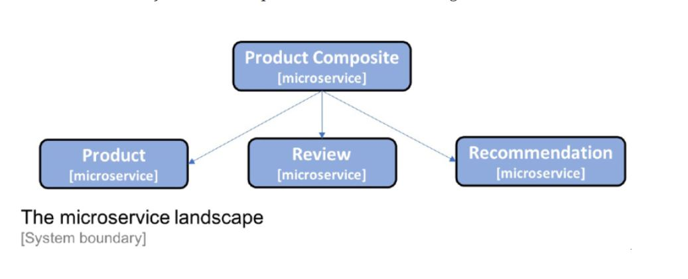

# cns-romania-readme

> **[Architecture & Roadmap](ARCHITECTURE-AND-ROADMAP.md)** — current system, endpoints, test suite,
> architectural diagrams, and the end-to-end plan through Kafka, Stripe checkout, Grafana monitoring
> and EKS. Start there.

#### Introducing the microservice landscape

**Design Patterns for Microservices**

|Design Pattern| Spring Boot|Spring Cloud | Kubernetes|Istio|
|----|---|----|----|---|
|Service discovery||Netflix Eureka and Spring Cloud LoadBalancer|Kubernetes kube-proxy and service resources|
|Edge server||Spring Cloud and Spring Security OAuth|Kubernetes Ingress controller|Istio ingress gateway|
|Reactive microservices|Project Reactor and Spring WebFlux|
|Central configuration||Spring Config Server|Kubernetes ConfigMaps and Secrets|
|Centralized log analysis| | |Elasticsearch, Fluentd, and Kibana Note: Actually not part of Kubernetes, but can easily be deployed and configured together with Kubernetes|
|Distributed tracing| |Spring Cloud Sleuth and Zipkin| | Jaeger|
|Circuit breaker| |Resilience4j| |Outlier detection|
|Control loop| | |Kubernetes controller managers| |
|Centralized monitoring and alarms| | | |Kiali, Grafana, and Prometheus|

It consists of three core microservices, the Product, Review, and Recommendation services,
all of which deal with one type of resource, and a composite microservice
called the Product Composite service, which aggregates 
information from the three core services.

I am keepting the things very simple to understand the overall.

**Product service**

The product service manages product information and 
describes each product with the following attributes:

Product ID

Name

image

brand

category

description

rating

numReviews

price

countInStock

**Review service**

The review service manages product reviews and stores 
the following information about each review:

name

rating

Comment

**Recommendation service**

The recommendation service manages product recommendations 
and stores the following information about each recommendation:

Product ID

Recommendation ID

Author

Rate

Content

**Product composite service**

The product composite service aggregates information from 
the three core services and presents information about 
a product as follows:

Product information, as described in the product service
A list of product reviews for the specified product, 
as described in the review service
A list of product recommendations for the specified product,
as described in the recommendation service

Infrastructure-related information
Once we start to run our microservices as containers 
that are managed by the infrastructure (first Docker and later on Kubernetes),
it will be of interest to track which container actually responded to our requests. 
As a simple solution, a serviceAddress attribute has been added 
to all responses, formatted as hostname/ip-address:port.

### Temporarily replacing service discovery

Since, at this stage, we don't have any service discovery mechanism in place, we will run all microservices on localhost and use hardcoded port numbers for each microservice. We will use the following ports:

Product composite service: 7000

Product service: 7001

Review service: 7002

Recommendation service: 7003

### Generating skeleton microservices

Task for you all

### For each microservice, we will create a Spring Boot project that does the following:

* Uses Maven/Gradle as a build tool
* Generates code for Java 8
* Packages the project as a fat JAR file
* Brings in dependencies for the Actuator and WebFlux Spring modules
* Is based on Spring Boot v2.5.2 (which depends on Spring Framework v5.3.8)

