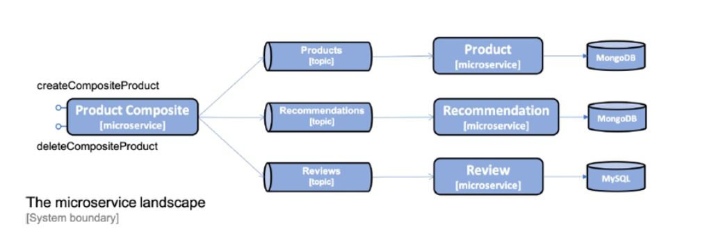

# Event Driven Asynchronous Services

The Composite service would publish `create and delete` events on each core service topic.

Composite service will not wait for processing by core service and returns OK to caller.

Spring Cloud Stream is a framework for building highly scaleable event-driven microservice connected with messaging system.

The programming model is functional paradigm (`Supplier, Function/Consumer`). 

