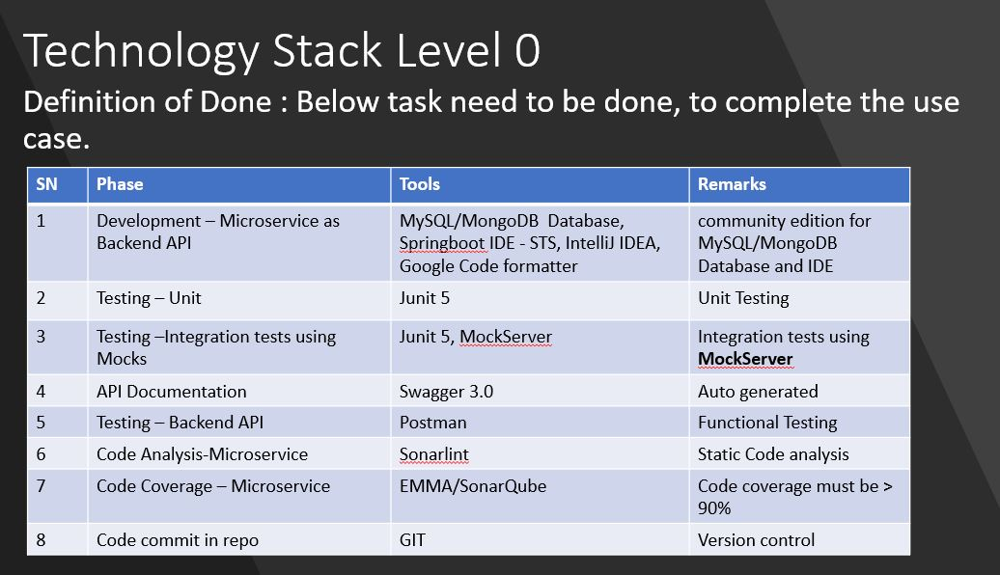
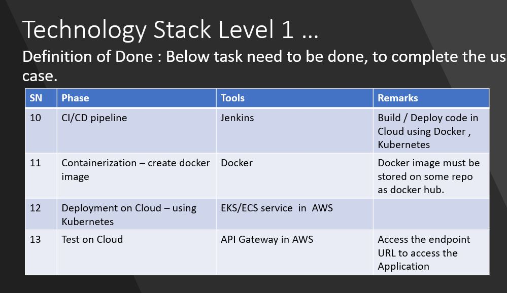

## HCL Gadgets

HCL Gadgets is a B2C(Business to Customer) type of ecommerce solution that involves customer gathering goods, collecting information on the goods and receiving these products over an electronic network. This type of eCommerce is second largest and earliest form of ecommerce. 

HCL  gadget specializes in online retail of electronics such as mobiles, laptops, tv, computers etc. It enables users to easily buy electronics over digital media. 

The system allows user to shop year around 24/7 without having to worry about anything. 

User can select products from various categories and different vendors.

B2C e-commerce transactions are not strictly bound to retail shopping. Many customers purchase health insurance, auto insurance and similar products online. 

HCL gadgets is just a small part of a very large system/domain. HCL gadgets strictly belongs to the retail domain. 

Retailers are part of an integrated system called the supply-chain which is again the management of the flow of goods and services, that involves the movement and storage of raw materials, of work-in-process inventory, and of finished goods from point of origin to point of consumption.

* NOTE: This document contains UI screenshots, They are for reference only and not be created as part of Microservices POC.

### Targeted Users
The target users for this project are the customers who are in the online retail market to buy electronic products such as TV, computer, phones with quality and best services. 

The customers will largely be using the application for purchase purposes but are always able to browse through the products and get the relevant information without actually having to make a purchase.

#### Functional Requirements
- Project Scope – Level 0
-   Use case– Design & Develop a APIs for 
-   get User details
-   user registration
-   login

Expected Output – Create User, Login, get user details using REST APIs using Spring webflux and MongoDB/ My SQL database. 
Microservices – User Service

Flow #1 – LEVEL 0
	
	Become a Member through Registration process

	Login to registered account

	Get User details
- Technology Stack Level 0

	Git– Version Control

	MySQL/ MongoDB – Database

	Java Spring-Boot-2.5 – API framework (webflux)

	Build tool - Gradle

	Postman– API verification

#### PROJECT SCOPE – LEVEL 1
* Use case– Design &  Develop APIs for 
-	get User details
-	user registration
-	Login
-	List products
-	Get product details

Expected Output –REST APIs using Spring webflux and MongoDB/ My SQL database. 

Microservices – User Service, Product Service, Recommend Service, Review Service

Flow #2 – LEVEL 1
	
	View Home Page 
	
	Browse products  by category
	
	Get Products by Ids/Filter
	
	View Product Details 
	
	Become a Member through Registration process 
	
	Login to registered account 

